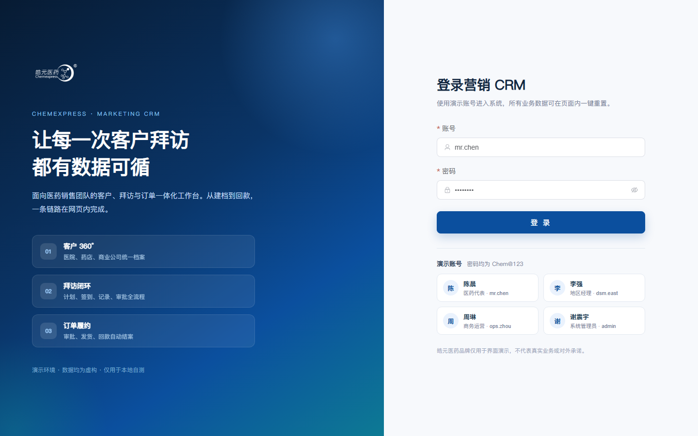
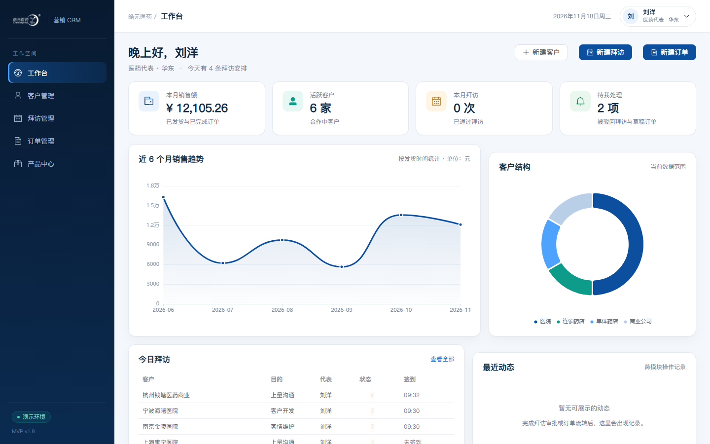
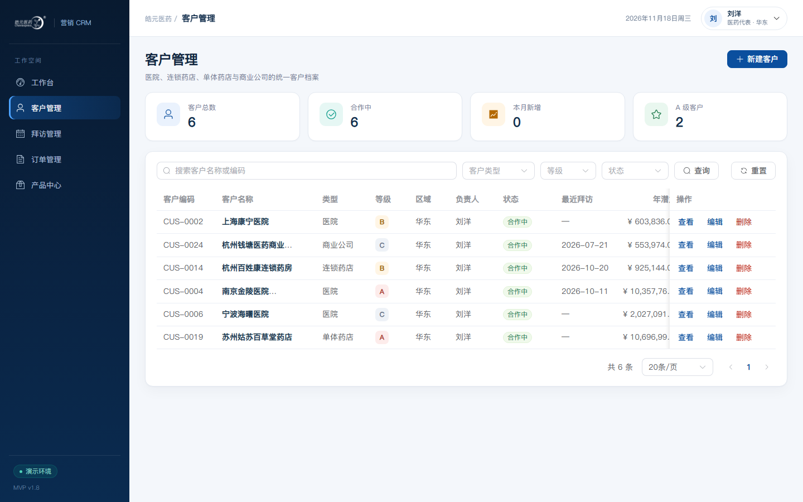
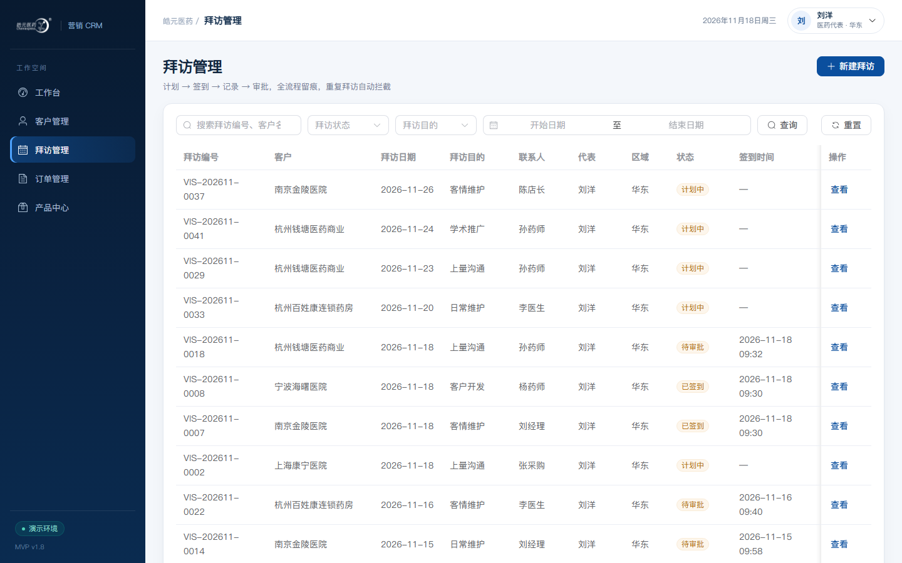
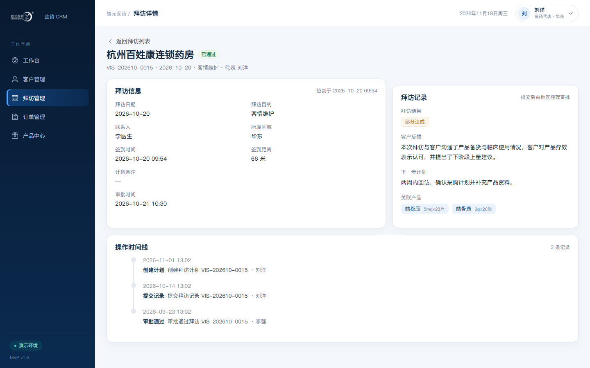
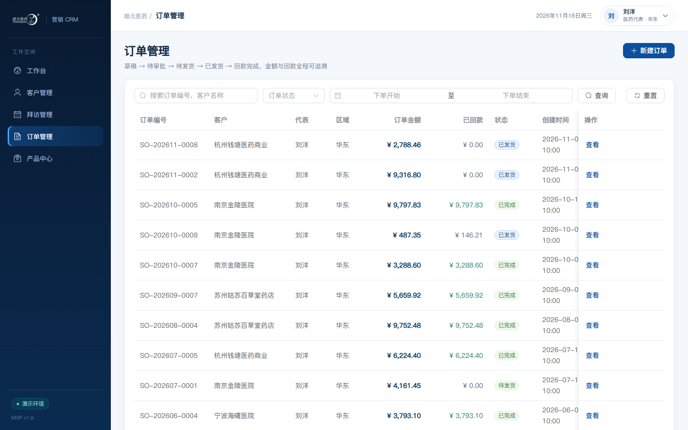
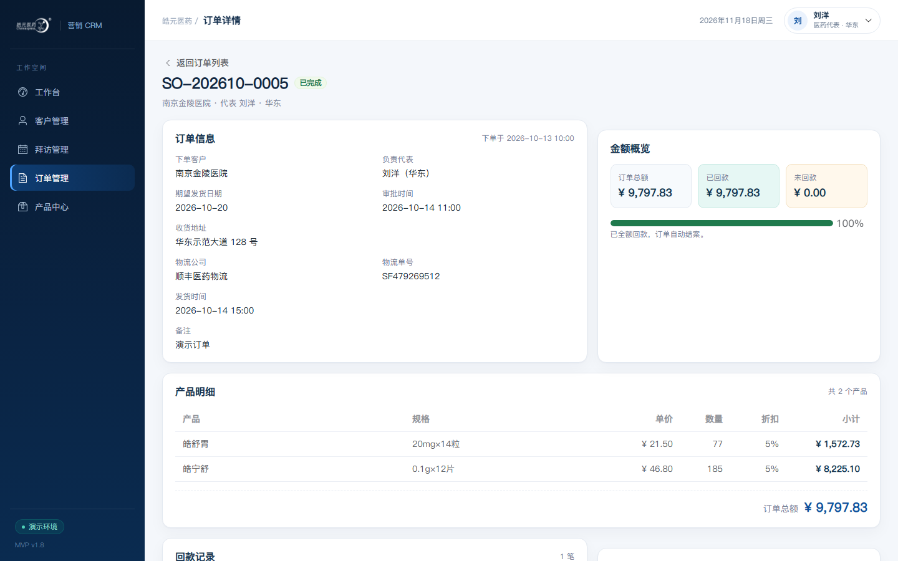
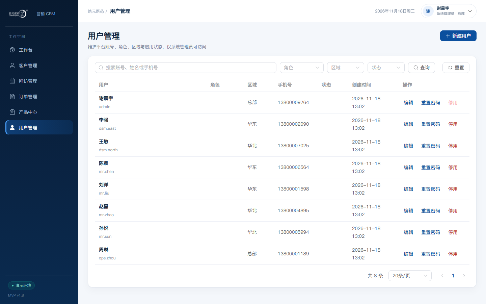

<div align="center">
  
  <h1>皓元医药营销 CRM</h1>
  <p>面向医药销售团队的客户、拜访与订单一体化管理演示系统</p>
  <p>
    
    
    
    
    
    
  </p>
</div>

> 本项目是技术演示系统：客户、联系人、产品、订单、拜访与回款数据全部为虚构，不代表任何真实业务。皓元医药（ChemExpress）名称与 Logo 仅用于界面演示，权利归其所有者。

## 项目简介

皓元医药营销 CRM 面向医药销售场景，围绕「客户 360° → 拜访闭环 → 订单履约 → 回款结案」这条主线，提供可在浏览器中完整自测的前后端分离应用。

系统内置四个角色、数据范围隔离、拜访与订单状态机、演示数据一键重置，克隆后无需外部数据库即可运行。

## 功能截图

<table>
  <tr>
    <td width="50%"><br /><sub>登录页：演示账号一键填充</sub></td>
    <td width="50%"><br /><sub>工作台：角色化 KPI、销售趋势、今日拜访</sub></td>
  </tr>
  <tr>
    <td width="50%"><br /><sub>客户管理：筛选、分级、负责人转交</sub></td>
    <td width="50%"><br /><sub>拜访管理：计划、签到、提交、审批</sub></td>
  </tr>
  <tr>
    <td width="50%"><br /><sub>拜访详情：时间线、产品与审批记录</sub></td>
    <td width="50%"><br /><sub>订单管理：草稿到回款的全流程状态</sub></td>
  </tr>
  <tr>
    <td width="50%"><br /><sub>订单详情：金额、发货、回款与操作时间线</sub></td>
    <td width="50%"><br /><sub>用户管理：账号、角色、区域与启停</sub></td>
  </tr>
</table>

## 核心能力

- **工作台**：按角色展示销售额、活跃客户、本月拜访、待处理事项，近 6 个月销售趋势、客户结构、今日拜访与最近动态。
- **客户 360°**：客户列表与筛选、医院/药店/商业公司分类、A/B/C 分级、负责人转交、联系人维护、客户下的拜访与订单页签。
- **拜访闭环**：计划 → 签到 → 填写记录 → 提交 → 审批/驳回 → 重提；同一客户同日重复拜访拦截；全程操作时间线。
- **订单履约**：草稿 → 待审批 → 待发货 → 已发货 → 已完成；审批、驳回、取消、发货登记、回款登记；全额回款自动结案，超额回款拦截。
- **产品中心**：产品只读目录，供拜访记录关联与订单明细选择。
- **用户管理**：管理员创建/编辑账号、分配角色与区域、重置密码、启用/停用；禁止停用自己、禁止移除最后一个启用的管理员。
- **演示数据重置**：管理员一键恢复 8 个账号、28 个客户、120 条拜访与 48 笔订单；重置后旧 JWT 立即失效。

## 角色与数据范围

| 角色 | 代码 | 数据范围 | 主要操作 |
| --- | --- | --- | --- |
| 系统管理员 | `ADMIN` | 全量 | 用户管理、数据重置、全局查看 |
| 地区经理 | `DSM` | 本区域 | 新建/转交客户、审批拜访与订单 |
| 医药代表 | `MR` | 本人客户 | 新建客户、拜访计划与记录、创建订单 |
| 商务运营 | `OPS` | 全量 | 代下单、发货登记、回款登记 |

数据范围在服务端统一校验，跨范围访问返回 403；前端菜单与按钮仅做辅助隐藏。

## 核心状态机

```text
拜访：PLANNED → CHECKED_IN → SUBMITTED → APPROVED
                                      ↘ REJECTED → SUBMITTED（重提）
       PLANNED / CHECKED_IN → CANCELLED

订单：DRAFT → PENDING → APPROVED → SHIPPED → COMPLETED
                  ↘ REJECTED
       未发货前可取消；全额回款自动进入 COMPLETED
```

关键规则：

- 只有「合作中」客户可以下单；新建客户默认为「潜在客户」。
- 拜访签到后才可提交记录；驳回后由原代表修改并重提。
- 订单金额由明细行「单价 × 数量 × 折扣」汇总，回款累计不得超过订单总额。
- 经理不能审批自己提交的单据；管理员不能停用自己。

## 技术栈

| 层 | 技术 |
| --- | --- |
| 后端 | Java 17、Spring Boot 3.3.5、Spring Security 6、JJWT 0.12.6、MyBatis-Plus 3.5.7、Jakarta Validation、Lombok |
| 数据库 | H2 2.2.224（文件模式，随应用启动建表） |
| 前端 | Vue 3.5、TypeScript、Vite 5、Element Plus 2.9、Pinia、Vue Router 4、Axios、ECharts 5、dayjs |
| 构建 | Maven 3.9+、npm 9+ |

## 快速开始

环境要求：JDK 17+、Maven 3.9+、Node.js 18+。

### 一键启动（Windows PowerShell）

```powershell
powershell -ExecutionPolicy Bypass -File scripts/start.ps1
```

脚本会自动打包后端、安装前端依赖并启动两个服务，然后打开浏览器。

### 手动启动

```bash
# 1. 启动后端（在仓库根目录执行）
cd backend
mvn -DskipTests package
java -jar target/chemexpress-crm-0.2.0.jar

# 2. 启动前端（另开一个终端）
cd frontend
npm install
npm run dev
```

访问 http://localhost:5173，后端 API 位于 http://localhost:8080/api/v1。

H2 数据文件默认生成在启动目录的 `data/crm.mv.db`，已被 `.gitignore` 忽略；删除该文件后重启即可重新播种。

### 演示账号

| 账号 | 姓名 | 角色 | 区域 |
| --- | --- | --- | --- |
| `admin` | 谢震宇 | 系统管理员 | 总部 |
| `dsm.east` | 李强 | 地区经理 | 华东 |
| `dsm.north` | 王敏 | 地区经理 | 华北 |
| `mr.chen` | 陈晨 | 医药代表 | 华东 |
| `mr.liu` | 刘洋 | 医药代表 | 华东 |
| `mr.zhao` | 赵磊 | 医药代表 | 华北 |
| `mr.sun` | 孙悦 | 医药代表 | 华北 |
| `ops.zhou` | 周琳 | 商务运营 | 总部 |

统一密码：`Chem@123`。

### 重置演示数据

使用管理员登录，点击右上角头像 →「演示数据重置」，输入 `RESET` 确认；或调用：

```http
POST /api/v1/system/reset
Authorization: Bearer <admin-token>
Content-Type: application/json

{ "confirm": "RESET" }
```

## 项目结构

```text
.
├── backend
│   ├── pom.xml
│   └── src/main
│       ├── java/com/chemexpress/crm
│       │   ├── controller    # REST 接口
│       │   ├── service       # 业务规则、状态机、数据范围
│       │   ├── mapper        # MyBatis-Plus Mapper
│       │   ├── entity        # 数据库实体
│       │   ├── dto           # 请求参数
│       │   ├── vo            # 响应模型
│       │   ├── security      # JWT、过滤器、当前用户
│       │   └── config        # 分页与乐观锁
│       └── resources
│           ├── application.yml
│           └── schema.sql
├── frontend
│   └── src
│       ├── api               # Axios 与接口封装
│       ├── layout            # 侧边栏与顶栏
│       ├── router            # 路由与管理员守卫
│       ├── stores            # 登录态、字典缓存
│       ├── views             # 工作台、客户、拜访、订单、产品、用户
│       └── styles            # 品牌色与全局样式
├── docs
│   ├── chemexpress-crm-spec.html        # 产品规格说明书
│   ├── chemexpress-crm-user-guide.html  # 网页使用手册
│   ├── assets
│   └── screenshots
├── scripts
│   └── start.ps1
└── README.md
```

## API 概览

| 方法 | 路径 | 说明 |
| --- | --- | --- |
| POST | `/api/v1/auth/login` | 登录并获取 JWT |
| GET | `/api/v1/meta/options` | 角色、区域、状态等字典 |
| GET | `/api/v1/dashboard` | 工作台聚合数据 |
| GET/POST/PUT/DELETE | `/api/v1/customers` | 客户查询、新建、编辑、删除、转交 |
| GET/POST/PUT/DELETE | `/api/v1/customers/{id}/contacts` | 联系人维护 |
| GET/POST | `/api/v1/visits` | 拜访查询、创建计划 |
| POST | `/api/v1/visits/{id}/check-in` | 签到 |
| POST | `/api/v1/visits/{id}/submit` | 提交拜访记录 |
| POST | `/api/v1/visits/{id}/approve` | 审批通过 |
| POST | `/api/v1/visits/{id}/reject` | 驳回 |
| GET/POST/PUT | `/api/v1/orders` | 订单查询、创建、编辑 |
| POST | `/api/v1/orders/{id}/submit` | 提交审批 |
| POST | `/api/v1/orders/{id}/approve` | 审批通过 |
| POST | `/api/v1/orders/{id}/ship` | 发货登记 |
| POST | `/api/v1/orders/{id}/payments` | 回款登记 |
| GET | `/api/v1/products` | 产品目录 |
| GET/POST/PUT | `/api/v1/users` | 用户管理（仅管理员） |
| POST | `/api/v1/system/reset` | 重置演示数据（仅管理员） |

## 设计说明

- 后端使用 JWT 无状态鉴权，Token 携带数据版本 `dv`；重置数据后版本递增，旧会话自动失效。
- 每次请求都会从数据库重新加载当前账号，因此停用账号、调整角色会立即生效。
- 客户表启用乐观锁 `version`，避免并发编辑覆盖。
- 演示数据以固定随机种子按当前日期滚动生成，保证每次重置后的分布稳定、日期始终贴近当前月份。
- 前端构建包含 `vue-tsc` 类型检查；后端可通过 `mvn -DskipTests package` 打包为可执行 Jar。

## 文档

- [产品规格说明书](docs/chemexpress-crm-spec.html)
- [网页使用手册](docs/chemexpress-crm-user-guide.html)

## 已知边界与后续方向

当前版本定位为可自测的 MVP，尚未覆盖：

- 生产级数据库（MySQL/PostgreSQL）与 Flyway 版本化迁移
- Refresh Token、密码策略、登录失败锁定、操作审计日志
- 附件上传（拜访照片、客户证照）、消息通知、定时任务
- 流向数据、目标绩效、市场活动、报表中心
- 多级审批流、信用额度、价格协议、库存与批次
- 移动端签到、GPS 围栏、离线缓存
- 单元测试、集成测试与 CI/CD

## 免责声明

本项目仅用于学习、演示与技术交流，不构成任何生产级交付。所有业务数据均为虚构；请勿将演示账号、默认 JWT 密钥或 H2 配置直接用于生产环境。
